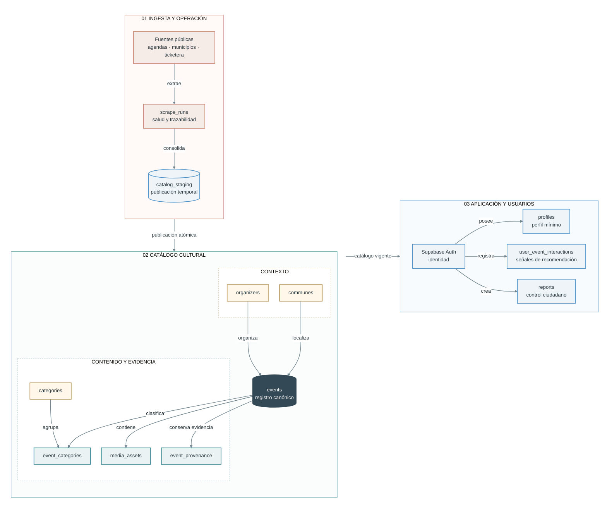

# Diccionario de datos · Eventos culturales de Chile

## 0. Control documental

| Campo | Valor |
|---|---|
| Tipo de documento | Documentación técnica |
| Título de portada | Base de datos de eventos culturales |
| Proyecto | MVP · Agregador de eventos culturales de Chile |
| Subtítulo | Diccionario de tablas, columnas, relaciones y categorías |
| Versión documentada | 28 de octubre de 2026 |
| Esquema | `public` de Supabase/PostgreSQL |
| Uso | Documento de uso personal |
| Encabezado | EVENTO CULTURAL · DOCUMENTACIÓN 2026 |
| Pie de página | Uso personal · Página |
| Título del índice | Contenido |
| Leyenda de figura 1 | Figura 1. Vista por capas del modelo de datos vigente. |

### Migraciones de referencia

- `supabase/migrations/20260831000100_initial_event_catalog.sql`
- `supabase/migrations/20260902000100_event_location_metadata.sql`
- `supabase/migrations/20260911000100_content_enrichment_and_organizer_controls.sql`
- `supabase/migrations/20260912000100_rewrite_state_and_reconciliation.sql`
- `supabase/migrations/20260921000100_atomic_catalog_publication.sql`
- `supabase/migrations/20260924000100_user_recommendation_interactions.sql`
- `supabase/migrations/20261020000100_cleanup_expired_events.sql`
- `supabase/migrations/20261020000200_optimize_event_matching.sql`
- `supabase/migrations/20261020000300_integrate_expired_cleanup.sql`
- `supabase/migrations/20261024000100_password_reset_tokens.sql`
- `supabase/migrations/20261027000100_cultural_classification.sql`
- `supabase/migrations/20261028000100_publish_existing_reviews.sql`

### Alcance y fuente de verdad

Este documento describe la base de datos del MVP, el significado de sus tablas y columnas,
las relaciones, las políticas de acceso y la taxonomía observada. El boceto visual original se
utilizó solamente como referencia relacional; los campos de esta base provienen del modelo real
`Event` y de las necesidades operativas del recolector.

> **Fuente de verdad:** ante cualquier diferencia entre este documento, el DBML y la instalación
> remota, prevalece el conjunto ordenado de migraciones SQL versionadas. La migración del 24 de
> septiembre reemplazó definitivamente `favorites` por `user_event_interactions`.

### Estado del modelo

La versión vigente reemplaza `favorites` por `user_event_interactions` y publica el catálogo
mediante `catalog_staging` y la función transaccional `publish_staged_catalog(...)`.
La revisión del 20 de octubre añade `cleanup_expired_events()`, optimiza la búsqueda previa a IA
con dos índices de URL y conecta la limpieza protegida con la publicación. No añade tablas ni
columnas, por lo que el modelo ER conserva sus entidades y relaciones.

### Registro de cambios del 20 de octubre de 2026

| Migración | Cambio | Efecto al instalar |
|---|---|---|
| `20261020000100` | Crea la RPC privada `cleanup_expired_events()` para eventos manuales y extraídos. Usa la hora del servidor y protege supresiones e interacciones. | Crea la función y sus permisos; no borra eventos. |
| `20261020000200` | Añade índices de URL y reescribe `match_existing_events(jsonb)` sin cambiar su contrato REST. | Construye índices y reemplaza la consulta; no modifica filas del catálogo. |
| `20261020000300` | Integra la limpieza en `publish_staged_catalog(...)` y protege la conciliación frente a eventos manuales o con interacciones. | Reemplaza la función de publicación; no la ejecuta. |

Las nueve migraciones locales y remotas quedaron sincronizadas el 20 de octubre. La aplicación
de estas migraciones no ejecutó el scraper ni una limpieza sobre el catálogo existente. El nuevo
comportamiento se utiliza en la siguiente publicación que termine correctamente.

### Recuperación de contraseñas del 24 de octubre de 2026

La migración `20261024000100_password_reset_tokens.sql` añade una tabla privada de seis columnas
para las Edge Functions de recuperación. Mantiene el contrato del SQL de la aplicación y añade
una transacción, espera máxima de bloqueos de cinco segundos y permisos explícitos: sin acceso
para `PUBLIC`, `anon` ni `authenticated`; `service_role` dispone de lectura, inserción,
actualización y borrado. No modifica eventos, perfiles, contraseñas ni las funciones del scraper.

RLS está activo sin políticas de navegador. El SQL no garantiza por sí solo que un token expire
o se consuma una única vez: esos controles pertenecen al backend. La revisión de la función
local de confirmación detectó que marca `used_at` después de actualizar la contraseña y no
comprueba el error de esa escritura; el consumo atómico y su manejo de fallos requieren una
corrección independiente. Instalar la tabla no despliega ni valida el envío de correo.

### Clasificación cultural del 27 de octubre de 2026

La migración `20261027000100_cultural_classification.sql` se verificó aplicada en Supabase el
28 de octubre mediante el historial remoto y la consulta del campo. Añade el objeto JSON
`event_provenance.classification` y conserva ese objeto durante la publicación atómica. Incluye
la RPC privada `apply_catalog_classifications(jsonb,text)`, ejecutable solo por `service_role`.
Instalarla no reclasifica ni borra eventos. No cambia las políticas de usuarios ni de autenticación.

La taxonomía versionada distingue disciplinas, formatos, públicos y programas; conserva las
etiquetas originales y la evidencia. Los directorios de librerías/museos no se consideran eventos.
Con la política restrictiva `quarantine`, los casos ambiguos quedan como `draft`; los rechazados se pueden archivar sin borrar filas ni
interacciones. La RPC de mantenimiento protege publicaciones manuales, supresiones, organizadores
bloqueados, fuentes inactivas y eventos ya cancelados/archivados. No modifica fechas ni textos.

El comando `python -m tools.reclassify_catalog` produce una simulación local sin NVIDIA. Solo
`--apply` habilita la escritura después de verificar la migración. Antes de aplicarlo se debe
revisar la propuesta, ya que puede reducir considerablemente el catálogo visible. Las categorías
sin asociaciones no se borran automáticamente, para no afectar referencias del backend.

### Visibilidad de revisiones del 28 de octubre de 2026

La configuración activa del scraper usa `cultural_review_action=keep`. Un candidato vigente puede
estar publicado y seguir clasificado como `review`: visibilidad y clasificación son dimensiones
distintas. `classification.review_action` registra la política aplicada y
`classification.publication_status` el destino automático; `events.is_suppressed` conserva la
ocultación administrativa persistente y no es sobrescrita por el scraper. El panel debe gestionar
esa marca mediante un backend autorizado para `admin`; estos cambios no implementan el panel.

La migración `20261028000100_publish_existing_reviews.sql` aplica una actualización de datos
acotada y atómica, sin tablas, columnas, índices ni permisos nuevos. Publica únicamente borradores
extraídos cuya procedencia acredita `decision=review`, `content_kind=event` y destino previo
`draft`, de la versión conocida del clasificador. Comprueba vigencia con el reloj de PostgreSQL
y el inicio del día en Santiago. Excluye fechas inconsistentes, eventos sin inicio, borradores
manuales, supresiones, organizadores bloqueados y fuentes inactivas o retiradas. No restaura
archivados/cancelados ni cambia categorías, textos, OCR o interacciones. Su repetición no vuelve
a modificar las filas ya publicadas.

Se aplicó y verificó en Supabase el 28 de octubre: 369 revisiones pasaron de borrador a publicadas,
manteniendo su decisión y evidencia. El conteo observado pasó de 577 publicados/371 borradores a
946 publicados/2 borradores; los 289 archivados y el total de 1.237 registros se conservaron.
Son cifras de esa comprobación, no cantidades fijas del catálogo.

La RPC y la herramienta `tools.reclassify_catalog` mantienen el modo conservador `quarantine`;
no deben ejecutarse con `--apply` para publicar pendientes. Las siguientes sincronizaciones
normales aplican `keep`, respetando las supresiones administrativas y los demás controles.

## 1. Vista general



Esta vista prioriza la lectura arquitectónica. Las entidades, columnas, claves y cardinalidades
formales se conservan en `modelo_er.mmd`. Ese archivo se genera desde la fuente canónica
`evento_cultural_modelo.dbml` mediante `python tools/generate_model_er.py`; no debe editarse
manualmente. La opción `--check` permite detectar divergencias antes de publicar documentación.

`scrape_runs` registra la salud de cada sincronización y no necesita una clave foránea hacia
los eventos. Una ejecución puede descubrir cientos de eventos, pero los eventos permanecen
vigentes entre ejecuciones mediante sus identificadores deterministas.

### Tablas de ingesta y catálogo

| Tabla | Finalidad |
|---|---|
| `sources` | Agenda, municipalidad, ticketera o sitio desde el que se obtuvo la información. |
| `organizers` | Institución o entidad responsable de organizar el evento. |
| `communes` | Ubicación administrativa normalizada del evento. |
| `categories` | Etiquetas temáticas, de formato, audiencia o procedencia. |
| `events` | Registro canónico de cada evento consolidado. |
| `event_categories` | Relación muchos-a-muchos entre eventos y categorías. |
| `media_assets` | Imágenes y futuros videos, audios o documentos asociados. |
| `event_provenance` | Evidencia privada: texto original, OCR y URL canónica. |
| `scrape_runs` | Bitácora técnica de ejecuciones locales y de GitHub Actions. |
| `catalog_staging` | Fragmentos privados temporales usados para publicar un lote de forma atómica. |

### Tablas de aplicación y usuarios

| Tabla | Finalidad |
|---|---|
| `profiles` | Perfil público mínimo asociado a Supabase Auth. |
| `user_event_interactions` | Señales de comportamiento para recomendaciones: visualizaciones, interés, descarte, aperturas y compartidos. |
| `reports` | Avisos de usuarios sobre información incorrecta o problemática. |
| `password_reset_tokens` | Registro privado de identificadores temporales para recuperación de contraseña mediante Edge Functions; no lo procesa el scraper. |

### Vistas y funciones operativas

| Objeto | Tipo | Finalidad |
|---|---|---|
| `public_event_catalog` | Vista pública | Entrega eventos publicados con `source_name` y `organizer_name`, respetando RLS, supresión y bloqueos. |
| `set_updated_at()` | Trigger function | Mantiene automáticamente las columnas `updated_at`. |
| `handle_new_user()` | Trigger function | Crea el perfil mínimo al registrarse un usuario en Supabase Auth. |
| `match_existing_events(jsonb)` | RPC privada de lectura | Detecta coincidencias por clave externa o URL antes de OCR y redacción; utiliza índices y devuelve una coincidencia por clave local. |
| `is_organizer_blocked(uuid)` | Función de seguridad | Permite aplicar la exclusión de organizadores sin exponer sus columnas administrativas. |
| `publish_staged_catalog(...)` | RPC privada y transaccional | Publica un lote completo desde staging, reconcilia registros obsoletos y elimina eventos vencidos. |
| `cleanup_expired_events()` | RPC privada | Devuelve la cantidad eliminada como `bigint`. Limpia vencidos usando el reloj de PostgreSQL y conserva supresiones e interacciones. |

## 2. Convenciones generales

- Todos los nombres usan `snake_case`.
- Las claves primarias son UUID. El scraper produce UUID v5 deterministas para el catálogo;
  repetir una extracción actualiza las mismas filas mediante `upsert`.
- `timestamptz` representa fecha y hora con zona horaria. Supabase la almacena internamente de
  forma normalizada y el cliente debe presentarla en `America/Santiago` cuando corresponda.
- Un valor `null` significa que la fuente no entregó el dato o que no pudo validarse. No debe
  interpretarse como una cadena vacía ni como `false`.
- `created_at` indica cuándo nació la fila; `updated_at`, su última modificación;
  `last_seen_at`, la última extracción en que el registro volvió a encontrarse.
- Las fechas textuales no interpretables, como “por confirmar”, descartan el evento antes de llamar
  a Supabase. Las fechas sin offset se localizan en `America/Santiago`. Si solo se conoce una fecha sin hora, PostgreSQL la recibe a medianoche;
  la versión actual todavía no posee un campo `is_all_day` para distinguir esos casos.
- `location` siempre contiene una etiqueta utilizable. `location_precision` evita confundir una
  región de respaldo con una dirección exacta y `location_source` registra cómo se obtuvo.
- La clave secreta de Supabase se utiliza únicamente en el scraper o en CI. Nunca pertenece al
  navegador, al frontend, al repositorio ni a los logs.

## 3. Diccionario de tablas y columnas

### `sources`

Catálogo de fuentes. Un registro representa el sitio o agenda de procedencia, no una página de
detalle individual.

| Columna | Tipo | Requisito | Significado |
|---|---|---|---|
| `id` | `uuid` | PK, obligatorio | UUID determinista derivado del nombre normalizado de la fuente. |
| `name` | `text` | Obligatorio, único sin distinguir mayúsculas | Nombre legible, por ejemplo `Chile Cultura`. |
| `website_url` | `text` | Opcional | Origen web principal, normalmente protocolo y dominio. |
| `is_active` | `boolean` | `true` por defecto | Indica si la fuente se considera activa para lectura pública. No activa ni desactiva el conector local. |
| `last_seen_at` | `timestamptz` | Opcional | Última carga en que la fuente aportó al menos un evento. |
| `created_at` | `timestamptz` | Automático | Momento de creación de la fila. |
| `updated_at` | `timestamptz` | Automático | Última actualización; mantenida por trigger. |

### `organizers`

Entidades que producen, convocan o gestionan eventos. Puede tratarse de una municipalidad,
corporación cultural, universidad, museo, productora u otra organización.

| Columna | Tipo | Requisito | Significado |
|---|---|---|---|
| `id` | `uuid` | PK, obligatorio | UUID determinista derivado del nombre normalizado. |
| `name` | `text` | Obligatorio, único sin distinguir mayúsculas | Nombre publicado por la fuente. |
| `entity_type` | `text` | Opcional | Clasificación futura, por ejemplo `municipality`, `university` o `producer`; el scraper actual envía `null`. |
| `last_seen_at` | `timestamptz` | Opcional | Última ejecución en que apareció la organización. |
| `is_blocked` | `boolean` | `false` por defecto | Si es `true`, el organizador y todos sus eventos dejan de ser visibles y de procesarse con IA. |
| `blocked_reason` | `text` | Opcional | Motivo administrativo de la exclusión. |
| `blocked_at` | `timestamptz` | Opcional | Momento en que se aplicó el bloqueo. |
| `created_at` | `timestamptz` | Automático | Momento de creación. |
| `updated_at` | `timestamptz` | Automático | Última modificación. |

### `communes`

Catálogo territorial. Su identidad combina país, región y comuna para evitar ambigüedades.

| Columna | Tipo | Requisito | Significado |
|---|---|---|---|
| `id` | `uuid` | PK, obligatorio | UUID determinista de `país + región + comuna`. |
| `name` | `text` | Obligatorio | Nombre de la comuna, por ejemplo `Santiago`. |
| `region` | `text` | Opcional | Región administrativa informada o inferida por el conector. |
| `country` | `text` | Obligatorio, `Chile` por defecto | País de la comuna. |
| `created_at` | `timestamptz` | Automático | Momento de creación. |
| `updated_at` | `timestamptz` | Automático | Última modificación. |

### `categories`

Catálogo dinámico de etiquetas. La tabla no limita las categorías a una lista cerrada porque cada
fuente puede incorporar nuevas taxonomías. El significado de las etiquetas observadas se detalla
en la sección 5.

| Columna | Tipo | Requisito | Significado |
|---|---|---|---|
| `id` | `uuid` | PK, obligatorio | UUID determinista del nombre normalizado; evita duplicados por mayúsculas o acentos. |
| `name` | `text` | Obligatorio, único sin distinguir mayúsculas | Etiqueta conservada para visualización. |
| `created_at` | `timestamptz` | Automático | Primera aparición de la categoría. |
| `updated_at` | `timestamptz` | Automático | Última modificación de su nombre. |

### `events`

Tabla central. Una fila es la representación consolidada de un evento luego de extraer, filtrar
por región y deduplicar todas las fuentes.

| Columna | Tipo | Requisito | Significado y origen |
|---|---|---|---|
| `id` | `uuid` | PK, obligatorio | UUID v5 derivado de `external_key`; estable entre ejecuciones. |
| `external_key` | `text` | Obligatorio, único | Identificador canónico de deduplicación. Usa título, fecha y lugar; si falta ubicación incorpora fuente y URL para evitar colisiones. |
| `source_id` | `uuid` | FK obligatoria → `sources.id` | Fuente que aportó el registro conservado. |
| `organizer_id` | `uuid` | FK opcional → `organizers.id` | Organizador normalizado; queda `null` si no se publicó. |
| `commune_id` | `uuid` | FK opcional → `communes.id` | Comuna normalizada; queda `null` si no pudo determinarse. |
| `title` | `text` | Obligatorio | Nombre público del evento. Los registros sin título se descartan antes de cargar. |
| `start_at` | `timestamptz` | Columna nullable; obligatorio para la ingesta | Inicio del evento con offset. El scraper descarta eventos sin una fecha válida. |
| `end_at` | `timestamptz` | Opcional | Término del evento; puede coincidir con el inicio o ser desconocido. |
| `venue` | `text` | Opcional | Nombre del recinto, sala, parque, viña o espacio virtual. |
| `address` | `text` | Opcional | Dirección textual publicada por la fuente. |
| `city` | `text` | Opcional | Ciudad o localidad; no sustituye la comuna administrativa. |
| `region` | `text` | Opcional | Copia denormalizada de la región para filtros rápidos. |
| `country` | `text` | Obligatorio, `Chile` por defecto | País del evento. |
| `postal_code` | `text` | Opcional | Código postal publicado o configurado para la fuente. |
| `latitude` | `double precision` | Opcional | Latitud validada entre -90 y 90. |
| `longitude` | `double precision` | Opcional | Longitud validada entre -180 y 180. |
| `location` | `text` | Obligatorio | Etiqueta canónica para mostrar y buscar, construida desde recinto, dirección y territorio. Nunca queda vacía. |
| `location_precision` | `text` | Obligatorio | Nivel disponible: `exact`, `coordinates`, `venue`, `commune`, `city`, `region`, `online` o `country`. |
| `location_source` | `text` | Obligatorio | Procedencia: `source-data`, `source-default`, `deterministic-inference`, `nvidia-nim` o `geographic-fallback`. |
| `status` | `text` | Obligatorio, `published` por defecto | Estado editorial: `published`, `cancelled`, `draft` o `archived`. Con `keep`, los candidatos aceptados y en revisión pueden publicarse; no sustituye la clasificación ni la supresión administrativa. |
| `is_suppressed` | `boolean` | `false` por defecto | Exclusión administrativa persistente; el scraper no la sobrescribe. |
| `suppression_reason` | `text` | Opcional | Motivo de la exclusión individual. |
| `suppressed_at` | `timestamptz` | Opcional | Momento en que se ocultó el evento. |
| `audience` | `text` | Opcional | Público objetivo textual, por ejemplo familiar o mayores de edad. |
| `is_free` | `boolean` | Opcional | `true`: gratuito; `false`: pagado; `null`: la fuente no permite determinarlo. |
| `description` | `text` | Opcional | Versión editorial factual destinada a publicación. No sustituye la evidencia privada. |
| `price_text` | `text` | Opcional | Precio tal como fue informado, incluidos rangos o condiciones. No es un valor numérico contable. |
| `currency` | `text` | Obligatorio, `CLP` por defecto | Moneda asociada a `price_text`; se recomienda código ISO 4217. |
| `image_url` | `text` | Opcional | Imagen principal para consultas sencillas. También se refleja en `media_assets`. |
| `source_url` | `text` | Opcional | Página exacta o endpoint desde el que se extrajo la información. |
| `official_url` | `text` | Opcional | Página oficial o canónica del evento, si es distinta de la fuente intermediaria. |
| `extraction_method` | `text` | Opcional | Método usado, por ejemplo API, JSON-LD, tarjetas HTML, Playwright o NVIDIA NIM. |
| `scraped_at` | `timestamptz` | Obligatorio | Momento en que el conector obtuvo el registro. |
| `last_seen_at` | `timestamptz` | Obligatorio | Última sincronización que volvió a encontrar el evento. Permite detectar registros posiblemente vencidos. |
| `created_at` | `timestamptz` | Automático | Primera inserción en Supabase. |
| `updated_at` | `timestamptz` | Automático | Último `upsert` o modificación. |

La eliminación de una fuente está restringida mientras tenga eventos. Si se elimina un organizador
o una comuna, su referencia en el evento se convierte en `null` y el evento permanece.

### `event_provenance`

Tabla privada para auditoría y reutilización de resultados. No tiene permisos para `anon` ni
`authenticated`.

| Columna | Tipo | Requisito | Significado |
|---|---|---|---|
| `event_id` | `uuid` | PK y FK → `events.id` | Evento al que pertenece la evidencia. |
| `original_url` | `text` | Opcional | URL normalizada utilizada en la deduplicación previa. |
| `source_description` | `text` | Opcional | Descripción saneada tal como fue obtenida de la fuente. |
| `ocr_text` | `text` | Opcional | Texto visible transcrito desde el afiche. |
| `is_rewritten` | `boolean` | Obligatorio | Indica si `events.description` difiere del texto original. |
| `classification` | `jsonb` | Objeto, predeterminado `{}` | Versión, etiquetas originales, disciplinas canónicas, formatos, públicos, programas, evidencia y decisión. Requiere la migración del 27 de octubre. |
| `updated_at` | `timestamptz` | Automático | Última actualización de la evidencia. |

### `event_categories`

Tabla puente. Un evento puede tener cero, una o muchas categorías, y una categoría puede pertenecer
a muchos eventos.

| Columna | Tipo | Requisito | Significado |
|---|---|---|---|
| `event_id` | `uuid` | PK compuesta, FK → `events.id` | Evento clasificado. Se elimina en cascada con el evento. |
| `category_id` | `uuid` | PK compuesta, FK → `categories.id` | Categoría asignada. Se elimina en cascada con la categoría. |
| `created_at` | `timestamptz` | Automático | Momento de creación de la asociación. |

Antes de reinsertar las categorías de un lote, el exportador elimina sus asociaciones anteriores.
Esto permite retirar una categoría que ya no aparezca en la fuente sin duplicar relaciones.

### `media_assets`

Recursos visuales o descargables asociados al evento. En el MVP solo se cargan imágenes.

| Columna | Tipo | Requisito | Significado |
|---|---|---|---|
| `id` | `uuid` | PK, obligatorio | UUID determinista de `evento + URL`. |
| `event_id` | `uuid` | FK obligatoria → `events.id` | Evento propietario; eliminación en cascada. |
| `url` | `text` | Obligatorio, única por evento | Dirección pública del recurso. |
| `media_type` | `text` | Obligatorio, `image` por defecto | Uno de `image`, `video`, `audio` o `document`. |
| `is_primary` | `boolean` | `false` por defecto | Señala el recurso principal. La imagen importada actualmente se marca `true`. |
| `created_at` | `timestamptz` | Automático | Momento de creación. |

### `scrape_runs`

Bitácora de observabilidad. Permite saber si una ejecución alcanzó Supabase, terminó correctamente
o falló durante la carga.

| Columna | Tipo | Requisito | Significado |
|---|---|---|---|
| `id` | `uuid` | PK, automático o enviado | Identificador único de la ejecución. |
| `started_at` | `timestamptz` | Obligatorio | Inicio de la sincronización con Supabase, posterior a la extracción completa. |
| `finished_at` | `timestamptz` | Opcional | Término exitoso o fallido; es `null` mientras figura `running`. |
| `status` | `text` | Obligatorio | `running`, `succeeded` o `failed`. |
| `events_count` | `integer` | No negativo | Cantidad de eventos consolidados que se intentó cargar. |
| `error_message` | `text` | Opcional | Resumen técnico del error, limitado por el cliente a 2.000 caracteres. |
| `metadata` | `jsonb` | `{}` por defecto | Entorno de ejecución: `runner`, repositorio, ID de GitHub Actions, commit y evento disparador. En publicaciones exitosas incluye `removed_stale` y `removed_expired`. |

Los fragmentos se cargan primero en `catalog_staging`, que no es visible al público. La función
`publish_staged_catalog` aplica el catálogo, relaciones y limpieza dentro de una única transacción;
si falla, las tablas públicas conservan el estado anterior.
`removed_stale` cuenta los registros retirados por ausencia en fuentes conciliadas;
`removed_expired`, los borrados después por vencimiento. No representan el total restante de la
base. Las ejecuciones históricas pueden no tener estas claves. La bitácora de éxito se actualiza
después de la RPC: si falla esa escritura, no revierte una publicación ya confirmada.

### `catalog_staging`

Área privada y temporal de publicación. No forma parte del catálogo consultado por el frontend.

| Columna | Tipo | Requisito | Significado |
|---|---|---|---|
| `run_id` | `uuid` | PK compuesta | Ejecución propietaria del fragmento. |
| `entity` | `text` | PK compuesta | Entidad contenida: fuentes, eventos, procedencia o relaciones. |
| `chunk_index` | `integer` | PK compuesta, no negativo | Orden del fragmento dentro de la entidad. |
| `payload` | `jsonb` | Obligatorio, arreglo | Filas serializadas que la RPC convertirá a tipos PostgreSQL. |
| `created_at` | `timestamptz` | Automático | Permite retirar staging abandonado después de siete días. |

RLS está habilitado y solo `service_role` puede leer o escribir esta tabla. El lote se elimina al
publicarse correctamente; si la RPC falla, permanece fuera del catálogo público para diagnóstico.

### `profiles`

Extensión mínima de `auth.users`. Se crea automáticamente después del registro en Supabase Auth.

| Columna | Tipo | Requisito | Significado |
|---|---|---|---|
| `id` | `uuid` | PK y FK → `auth.users.id` | Identidad del usuario autenticado. |
| `display_name` | `text` | Opcional | Nombre visible; el usuario puede modificar solo esta columna. |
| `role` | `text` | `visitor` por defecto | Rol interno: `visitor`, `editor` o `admin`. No es editable directamente por el usuario. |
| `created_at` | `timestamptz` | Automático | Creación del perfil. |
| `updated_at` | `timestamptz` | Automático | Última modificación. |

### `user_event_interactions`

Historial de señales que usa el motor de recomendaciones. No almacena un puntaje enviado por el
cliente: el backend asigna el peso de cada tipo de interacción y puede reducir su efecto con el
paso del tiempo.

| Columna | Tipo | Requisito | Significado |
|---|---|---|---|
| `id` | `uuid` | PK, automático | Identificador de la interacción. |
| `user_id` | `uuid` | FK obligatoria → `auth.users.id` | Persona que generó la señal. |
| `event_id` | `uuid` | FK obligatoria → `events.id` | Evento asociado a la señal. |
| `interaction_type` | `text` | Obligatorio, controlado | Acción: ver detalle, abrir fuente u oficial, mostrar interés, descartar, compartir o reportar. |
| `occurred_at` | `timestamptz` | Automático | Momento de la interacción. |
| `metadata` | `jsonb` | Objeto vacío por defecto | Contexto no sensible opcional, por ejemplo superficie de origen. |

### `password_reset_tokens`

Tabla privada de soporte a las Edge Functions `reset-password-request` y
`reset-password-confirm`. No almacena contraseñas ni el JWT firmado completo; almacena su
identificador `jti` y el estado operativo. El correo es un dato personal y no se expone al cliente.

| Columna | Tipo | Requisito | Significado |
|---|---|---|---|
| `jti` | `uuid` | PK obligatoria, sin valor por defecto | Identificador aleatorio generado por el backend para asociar el JWT temporal con una única fila. |
| `user_id` | `uuid` | FK obligatoria → `auth.users.id` | Cuenta destinataria; al eliminarla, sus tokens se eliminan en cascada. |
| `email` | `text` | Obligatorio | Correo asociado a la solicitud, normalizado por el backend. |
| `expires_at` | `timestamptz` | Obligatorio | Vencimiento que las Edge Functions deben comprobar; la tabla no ejecuta expiración automática. |
| `used_at` | `timestamptz` | Opcional | Marca de consumo; `null` indica que no se ha registrado su utilización. |
| `created_at` | `timestamptz` | Automático, `now()` | Momento de creación; permite contar solicitudes recientes. |

La PK impide identificadores duplicados. Los índices `idx_password_reset_tokens_email` y
`idx_password_reset_tokens_expira` soportan búsquedas por correo y limpieza por vencimiento.
El scraper no carga, concilia ni elimina esta tabla. Su ciclo de vida corresponde al backend de
recuperación, sin ampliar los permisos del frontend.

### `reports`

Reportes de usuarios sobre un evento, por ejemplo fecha incorrecta, evento cancelado o enlace roto.

| Columna | Tipo | Requisito | Significado |
|---|---|---|---|
| `id` | `uuid` | PK, automático | Identificador del reporte. |
| `user_id` | `uuid` | FK obligatoria → `auth.users.id` | Persona que lo creó. |
| `event_id` | `uuid` | FK obligatoria → `events.id` | Evento reportado. |
| `reason` | `text` | Obligatorio | Motivo escrito por el usuario. |
| `status` | `text` | `pending` por defecto | Flujo de revisión: `pending`, `reviewed` o `resolved`. |
| `created_at` | `timestamptz` | Automático | Fecha de creación. |
| `updated_at` | `timestamptz` | Automático | Última modificación administrativa. |

## 4. Índices y reglas de integridad

- `sources`, `organizers` y `categories` poseen unicidad por nombre sin distinguir mayúsculas.
- `communes` es única por país, región y comuna.
- `events.external_key` es único y evita duplicados lógicos.
- `event_categories` no permite repetir el mismo par evento-categoría.
- `media_assets` no permite repetir la misma URL dentro de un evento.
- Existen índices para fecha de inicio, región, estado, fuente, comuna y búsquedas por categoría.
- Los valores de estados, roles y tipos multimedia se controlan mediante restricciones `check`.

### Índices de deduplicación previa a IA

`events_match_source_url_idx` y `events_match_official_url_idx` son índices B-tree de expresión.
Ambos utilizan `lower(split_part(rtrim(url, '/'), '#', 1))`, sustituyendo `url` por su columna
respectiva. El cliente envía la URL candidata normalizada; la consulta mantiene exactamente la
misma expresión en el lado almacenado para poder utilizar esos índices. La clave
`external_key` conserva el índice único que ya tenía.

La RPC separa las búsquedas por clave, URL de extracción y URL oficial mediante `UNION ALL`.
Después conserva la coincidencia con `last_seen_at` más reciente por `local_key`; ante empate,
ordena por `events.id`. Sigue devolviendo los textos editoriales, el OCR, la procedencia y la
supresión existentes. Es `STABLE`, no modifica datos y mantiene la firma REST anterior.

## 5. Diccionario de categorías observadas

Antes de la revisión del 27 de octubre las categorías eran dinámicas: se copiaban desde las
fuentes y se complementaban con reglas locales, mezclando disciplinas con otros conceptos.
Con la nueva clasificación, `categories` contiene únicamente las 18 disciplinas canónicas de
`eventos/classification.py`; formatos, públicos, programas y etiquetas originales se conservan
en el objeto privado `classification`. No se asigna «Otros» por falta de evidencia: esos casos
quedan clasificados como `review`, visibles con `keep` o como borradores con `quarantine`.
Las tablas siguientes no son la taxonomía nueva.

Esta sección conserva una **fotografía histórica** del archivo
local del 1 de septiembre de 2026: **399 eventos y 61 etiquetas**; no representa el catálogo
vigente y la cantidad puede cambiar en cada corrida.

### Disciplinas y contenidos culturales

| Categoría | Eventos observados | Definición operativa |
|---|---:|---|
| `Música` | 34 | Conciertos, recitales y actividades donde la música es el contenido principal. |
| `Teatro` | 16 | Obras teatrales, dramaturgia y presentaciones escénicas teatrales. |
| `Cine` | 13 | Exhibiciones, ciclos, festivales o conversaciones centradas en obras audiovisuales. |
| `Artes escénicas` | 12 | Categoría amplia para teatro, danza, performance, circo u otras artes en vivo. |
| `Danza` | 9 | Presentaciones, encuentros o formación cuyo contenido principal es el movimiento y la danza. |
| `Artes mediales` | 7 | Creación artística basada en medios digitales, audiovisuales, interactivos o tecnológicos. |
| `Artes visuales` | 20 | Pintura, escultura, grabado, instalación y otras expresiones principalmente visuales. |
| `Artesanía` | 3 | Oficios y objetos elaborados mediante técnicas artesanales. |
| `Fotografía` | 3 | Exposiciones, talleres o actividades centradas en fotografía. |
| `Literatura` | 3 | Libros, lectura, escritura, poesía o mediación literaria. |
| `Ópera` | 2 | Representaciones o actividades relacionadas con ópera y canto lírico. |
| `Títeres` | 1 | Espectáculos o actividades de teatro de muñecos y objetos. |
| `Humanidades` | 3 | Reflexión, investigación o divulgación en historia, filosofía, letras y áreas afines. |
| `Patrimonio cultural` | 3 | Salvaguardia, difusión o activación de patrimonio material e inmaterial. |
| `Cultura` | 24 | Etiqueta transversal cuando la fuente no entrega una disciplina cultural más específica. |
| `Gestión cultural` | 2 | Formación, redes o prácticas de administración y producción cultural. |
| `Encuentros Culturales y Artísticos` | 1 | Reuniones o actividades participativas que integran más de una disciplina artística. |

### Formatos, espacios y programas

| Categoría | Eventos observados | Definición operativa |
|---|---:|---|
| `Taller` | 15 | Actividad formativa o práctica con participación activa de asistentes. |
| `Exposición` | 8 | Muestra abierta al público, temporal o permanente. |
| `Feria` | 6 | Encuentro con múltiples expositores, puestos o participantes. |
| `Festival` | 1 | Programación concentrada que reúne varias actividades bajo una convocatoria común. |
| `Actividad` | 12 | Tipo genérico utilizado cuando no existe un formato más preciso. |
| `Evento` | 3 | Etiqueta genérica de la fuente; aporta poca información temática. |
| `Museo` | 31 | Actividad o ficha asociada a un museo o espacio museal. |
| `Bibliotecas` | 7 | Actividad vinculada a bibliotecas y servicios bibliotecarios. |
| `Biblioverano` | 1 | Programa o campaña estacional de actividades bibliotecarias durante el verano. |
| `Guía de Librerías` | 89 | Ficha de una librería dentro de Chile Cultura; puede representar un lugar o directorio, no necesariamente un evento. |
| `Guía de ferias y festivales del libro` | 12 | Ficha de una feria o festival literario dentro de una guía; debe verificarse que posea fecha de evento. |
| `Agenda Ciudad` | 8 | Taxonomía de Valpo Cultura para actividades de agenda urbana o ciudadana. |
| `Agenda Cultural Municipal` | 1 | Actividad perteneciente a una programación cultural municipal. |
| `Agenda Teatro Municipal` | 1 | Actividad publicada dentro de la programación de un teatro municipal. |
| `Rutas Patrimoniales y Turísticas` | 2 | Recorridos o circuitos vinculados a patrimonio y turismo. |

### Vino, gastronomía y turismo

| Categoría | Eventos observados | Definición operativa |
|---|---:|---|
| `Enoturismo` | 50 | Experiencias turísticas vinculadas a viñas, bodegas, vino y territorio vitivinícola. |
| `Vino` | 50 | Actividades donde el vino es tema o producto central. |
| `Festivales del Vino y la Gastronomía` | 48 | Vendimias, festivales, celebraciones y ferias que combinan vino y oferta gastronómica. |
| `Gastronomía` | 1 | Ferias, degustaciones o encuentros enfocados principalmente en alimentos y cocina. |
| `Turismo` | 4 | Actividades y experiencias orientadas a visitantes o promoción de destinos. |

### Ferias sectoriales, ciencia y desarrollo

| Categoría | Eventos observados | Definición operativa |
|---|---:|---|
| `Negocios` | 6 | Ferias y encuentros profesionales con foco comercial o empresarial. |
| `Construcción` | 1 | Exposición o encuentro del sector construcción e infraestructura. |
| `Industria naval` | 1 | Exposición o encuentro de actividades navales, marítimas y proveedores asociados. |
| `Minería` | 1 | Feria o encuentro profesional del ecosistema minero. |
| `Salud` | 1 | Actividad sectorial relacionada con salud, atención o bienestar. |
| `Tecnología` | 1 | Evento donde innovación o tecnologías son el tema central. |
| `Emprendimiento` | 1 | Actividad de apoyo, formación o vinculación para emprendimientos. |
| `Ciencias` | 2 | Divulgación, investigación o actividades científicas. |
| `Medio ambiente` | 2 | Conservación, sostenibilidad, naturaleza o problemáticas ambientales. |
| `Deportes` | 1 | Actividad cuyo componente principal es deportivo. |

### Audiencias, comunidades y clasificación institucional

| Categoría | Eventos observados | Definición operativa |
|---|---:|---|
| `Personas-Mayores` | 5 | Etiqueta de audiencia para actividades destinadas o especialmente pertinentes a personas mayores. |
| `Pueblos-Originarios` | 5 | Actividades vinculadas a pueblos indígenas, sus culturas, memorias o comunidades. |
| `Vinculación con el Medio` | 8 | Taxonomía UOH para actividades de relación entre universidad y entorno social o territorial. |
| `Institucional` | 4 | Actividad general de la institución; no describe necesariamente el contenido cultural. |
| `Educación Continua` | 1 | Formación posterior o complementaria ofrecida por la universidad. |
| `Dirección de Salud Mental` | 1 | Unidad UOH responsable o asociada; funciona más como procedencia organizacional que como tema. |
| `Escuela de Ciencias Sociales` | 1 | Unidad académica UOH asociada al evento. |
| `Escuela de Educación` | 1 | Unidad académica UOH asociada al evento. |
| `ECA3` | 3 | Escuela de Ciencias Agroalimentarias, Animales y Ambientales de la UOH. |
| `ICA3` | 2 | Instituto de Ciencias Agroalimentarias, Animales y Ambientales de la UOH. |
| `ICSo` | 2 | Instituto de Ciencias Sociales de la UOH. |
| `ICED` | 1 | Instituto de Ciencias de la Educación de la UOH; su estilización institucional es `ICEd`. |
| `PAOCC` | 2 | Programa de Apoyo a Organizaciones Culturales Colaboradoras del Ministerio de las Culturas. |

Las expansiones de ECA3, ICA3, ICSo e ICEd se verificaron en páginas institucionales de la
[Universidad de O’Higgins](https://www.uoh.cl/). PAOCC se verificó en el sitio oficial del
[Ministerio de las Culturas, las Artes y el Patrimonio](https://www.cultura.gob.cl/paocc/).

### Etiqueta que debe corregirse

| Etiqueta | Eventos observados | Diagnóstico |
|---|---:|---|
| `Calendar_Month Inscribirse` | 27 | Ruido de interfaz capturado desde Maipú en Común. Combina texto de un icono/calendario y un botón; no debe mostrarse como categoría pública. Se recomienda eliminarla durante la normalización. |

## 6. Recomendación de taxonomía

La lista actual mezcla cuatro dimensiones distintas: tema, formato, audiencia y procedencia. Para
el MVP esto conserva fielmente la fuente, pero una interfaz de filtros más limpia debería añadir a
`categories` una clasificación futura como:

| Tipo propuesto | Ejemplos |
|---|---|
| `discipline` | Música, Teatro, Cine, Literatura. |
| `format` | Taller, Feria, Festival, Exposición. |
| `topic` | Vino, Patrimonio cultural, Medio ambiente. |
| `audience` | Personas-Mayores, Pueblos-Originarios. |
| `sector` | Minería, Construcción, Industria naval. |
| `program` | Biblioverano, PAOCC. |
| `source_taxonomy` | Agenda Ciudad, ECA3, ICA3, ICSo, ICEd. |

También se recomienda incorporar `slug`, `description`, `category_type` e `is_active` en una
migración posterior, además de una tabla de alias. Así, `Ópera` y `opera`, o etiquetas equivalentes
entre fuentes, pueden apuntar a una categoría canónica sin perder el texto original.

## 7. Seguridad y acceso

La migración habilita Row Level Security en todas las tablas.

| Rol | Acceso efectivo |
|---|---|
| `anon` | Lectura de fuentes activas, organizadores no bloqueados, comunas, categorías y eventos publicados de organizadores permitidos. |
| `authenticated` | La misma lectura pública; además puede leer/editar su nombre de perfil, registrar/eliminar sus propias interacciones y crear/ver sus propios reportes. |
| `service_role` | Acceso completo para el proceso de ingesta. Debe permanecer exclusivamente en backend o CI. |

`scrape_runs` no posee lectura pública. El usuario no puede cambiar su propio `role` ni actualizar
el estado de sus reportes desde el frontend.

La vista `public_event_catalog` está disponible para `anon`, `authenticated` y `service_role`.
Une cada evento con `source_name` y `organizer_name`; con usuarios públicos hereda las políticas
RLS de las tablas y, por tanto, no expone eventos suprimidos ni organizadores bloqueados.

`event_provenance`, `catalog_staging`, `scrape_runs`, `match_existing_events(jsonb)`,
`cleanup_expired_events()` y `publish_staged_catalog(...)` no se exponen al navegador. Se reservan al proceso de ingesta que
opera con `service_role`. La función `is_organizer_blocked(uuid)` puede ejecutarse desde las
políticas públicas, pero solo devuelve un booleano y no revela el motivo ni la fecha del bloqueo.
`password_reset_tokens` también deniega el acceso de `anon` y `authenticated`; sus permisos
de lectura y escritura corresponden al backend con `service_role`, no al usuario autenticado.

## 8. Ciclo de carga

1. Se recorren todas las fuentes habilitadas.
2. Los conectores producen objetos `Event` con un esquema común.
3. El pipeline elimina duplicados y fija un identificador estable.
4. Se aplican metadatos geográficos estáticos y reglas deterministas.
5. Supabase identifica coincidencias por clave externa o URL original/oficial y devuelve los
   organizadores bloqueados. La clave externa procede de la consolidación título-fecha-lugar.
6. Solo los eventos nuevos, modificados o con enriquecimiento pendiente pasan por OCR, redacción
   editorial y normalización NVIDIA. Los que no cambiaron reutilizan los resultados guardados.
7. Se filtran regiones y pertinencia cultural, y se genera la ubicación canónica.
8. Se generan respaldos JSON y CSV.
9. Se crea una fila `running` en `scrape_runs`.
10. Se cargan fragmentos privados en `catalog_staging`.
11. `publish_staged_catalog(...)` publica entidades, eventos, procedencia y relaciones; concilia
    ausencias y, si está habilitado, llama a `cleanup_expired_events()` en la misma transacción.
12. La ejecución se marca `succeeded` o `failed`.

La carga empieza **después** de finalizar la extracción completa; no se sube un evento inmediatamente
después de encontrarlo. `SUPABASE_BATCH_SIZE` controla los fragmentos de carga. Para las consultas
de coincidencias, el cliente acota cada lote entre 1 y 500 candidatos, incluso si la configuración
es mayor; el workflow utiliza 200. Así evita que una respuesta de más de 1.000 coincidencias se
trunque con el límite habitual de filas de PostgREST.
Todas las operaciones NVIDIA comparten el límite `NVIDIA_RPM_LIMIT`; con el valor 40 se fuerza
un intervalo seguro de al menos 1,55 segundos entre inicios de solicitudes.

### Reglas de limpieza por vencimiento

Con `SUPABASE_DELETE_EXPIRED=true`, la publicación invoca `cleanup_expired_events()` después de
la conciliación. Es una función PostgreSQL invocable por RPC, no un trigger ni un `PROCEDURE`
que requiera `CALL`. Su reloj de referencia es `now()` del servidor, correspondiente al inicio
de la transacción. La firma antigua de publicación conserva `p_current_time` y `p_day_start`
por compatibilidad, pero ya no los utiliza para decidir el vencimiento.

- Si existe `end_at`, elimina solo cuando `end_at < now()`.
- Si no existe `end_at`, elimina solo cuando `start_at` es anterior al comienzo del día actual
  en `America/Santiago`; conserva un evento sin término durante todo su día local.
- Requiere `start_at` no nulo y una cronología coherente: `end_at` nulo o mayor o igual al inicio.
- Conserva cualquier evento suprimido o con al menos una interacción de usuario, positiva o
  negativa. No distingue entre creación manual y extracción para evaluar el vencimiento.
- Las categorías asociadas, los medios y la procedencia se eliminan por las cascadas existentes.

La función devuelve el número de eventos borrados y una segunda llamada sin cambios devuelve
cero. Aplica un bloqueo `SHARE` sobre `user_event_interactions` para impedir que una interacción
concurrente se pierda durante la comprobación y el borrado. El tiempo de espera de bloqueos se
limita a cinco segundos. Las inserciones de interacciones pueden esperar mientras dure la
transacción de publicación; ante contención no resuelta, la operación falla y se revierte.

### Reglas de conciliación por ausencia

Con `SUPABASE_RECONCILE_STALE=true`, la publicación retira filas de las fuentes autorizadas para
conciliar cuyo `last_seen_at` es anterior a `p_seen_at`. Además exige procedencia en
`event_provenance`, un método distinto de `manual`, ausencia de supresión y ausencia de
interacciones. Los eventos manuales no desaparecen por faltar en una página extraída.

Una fuente completa o vacía de forma confirmada puede autorizar esta conciliación; una fuente
parcial o fallida no la autoriza. Las fuentes retiradas explícitamente en configuración también
pueden conciliarse. Esta regla es independiente del vencimiento: una ficha ausente puede
retirarse aunque tuviera fecha futura. Ambas rutas de borrado son parte de la misma transacción;
si falla cualquier paso, se revierten publicación, relaciones y borrados, y se conserva staging.

## 9. Consultas útiles

### Próximos eventos publicados

```sql
select id, title, start_at, venue, city, region, is_free
from public.events
where status = 'published'
  and start_at is not null
  and not is_suppressed
  and (end_at is null or end_at >= start_at)
  and (
    end_at >= now()
    or (end_at is null and start_at >=
      (date_trunc('day', now() at time zone 'America/Santiago')
        at time zone 'America/Santiago'))
  )
order by start_at nulls last;
```

### Eventos con sus categorías

```sql
select
  e.id,
  e.title,
  array_agg(c.name order by c.name) as categories
from public.events e
left join public.event_categories ec on ec.event_id = e.id
left join public.categories c on c.id = ec.category_id
group by e.id, e.title
order by e.title;
```

### Cantidad por fuente

```sql
select s.name as source, count(*) as events
from public.events e
join public.sources s on s.id = e.source_id
group by s.id, s.name
order by events desc;
```

### Últimas ejecuciones

```sql
select started_at, finished_at, status, events_count, error_message, metadata
from public.scrape_runs
order by started_at desc
limit 20;
```

### Borrados registrados por sincronización

```sql
select started_at, status, events_count,
       metadata ->> 'removed_stale' as removed_stale,
       metadata ->> 'removed_expired' as removed_expired
from public.scrape_runs
order by started_at desc
limit 20;
```

Esta consulta es administrativa; `scrape_runs` no tiene lectura pública.

## 10. Validación de migraciones

`tools/test_database.sh` instala todas las migraciones ordenadas y ejecuta los archivos SQL de
`supabase/tests/` sobre una base temporal vacía llamada `eventos_test`. El fixture mínimo de Auth
simula usuarios y roles para probar el catálogo; no valida el servicio Supabase Auth real. El
script no lee `.env`. Nunca se debe apuntar a la base de producción.

Las pruebas cubren vencimiento con y sin término, día local chileno, fechas incoherentes,
supresiones, señales positivas y negativas, cascadas, idempotencia, permisos privados, búsqueda
por clave/URL, lotes de 1.205 candidatos y rollback de publicación después de un fallo forzado.
El workflow añade un trabajo `validate` con PostgreSQL 17 temporal y exige su éxito antes de
ejecutar `scrape`. No aplica migraciones remotas automáticamente en cada ejecución.

El 20 de octubre se verificaron localmente las nueve migraciones y las tres suites SQL en
PostgreSQL embebido mediante PGlite, con zonas UTC, Santiago y Tokio. Pasaron también las
144 pruebas de Python, incluida la comprobación de que este diccionario referencia todas las
migraciones versionadas. Esto no sustituye la primera ejecución del nuevo trabajo en GitHub
Actions con PostgreSQL 17; su resultado se consulta en el workflow después del push.

La regresión SQL añadida el 24 de octubre verifica además el esquema de recuperación: RLS,
ausencia de permisos públicos incluso para `TRUNCATE`, permisos CRUD del backend, valores
predeterminados, unicidad de `jti`, referencia a usuarios y cascada al eliminar el usuario
ficticio. Se ejecuta con rollback y no envía correos ni cambia contraseñas reales.

## 11. Limitaciones conocidas

- No existe todavía una marca explícita para eventos de día completo.
- `price_text` no permite comparar precios numéricamente.
- Las categorías proceden de varias fuentes y todavía no cuentan con jerarquía o tipo almacenado.
- Algunos registros de Chile Cultura parecen corresponder a directorios de lugares o guías, no a
  eventos fechados; deben distinguirse en una futura regla de calidad.
- `Calendar_Month Inscribirse` es una etiqueta inválida conocida.
- La limpieza conserva eventos con interacciones para no perder señales del recomendador.
  Esta protección es temporal: antes de eliminarlos habrá que desacoplar o agregar esas señales.
  Conservar una fila no implica que esté vigente; el frontend debe filtrar fechas en sus consultas.
- Las supresiones y las fechas incompletas o incoherentes se conservan para control o revisión;
  la función no corrige automáticamente fechas erróneas.
- Con `SUPABASE_RECONCILE_STALE=true`, una fuente `succeeded` o `complete_empty` puede retirar
  registros ausentes. Una fuente `partial` o `failed` nunca autoriza esa limpieza.
- La publicación pública es transaccional; una carga de staging interrumpida no modifica el catálogo.
